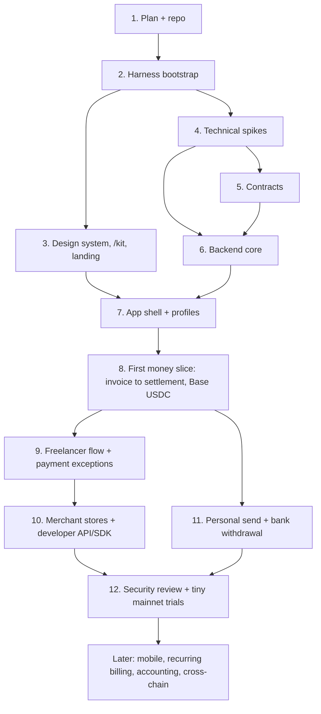

# Forwend: MVP plan

Forwend is a stablecoin payment app. One login can hold personal, freelancer and merchant
profiles. People get paid in USDC/USDT through invoices, payment links, hosted checkout or our
API, keep the balance in stablecoins, send it to other profiles or outside wallets, and withdraw
to a bank when they choose.

- Name: Forwend. Domain: forwend.com. The domain is not registered yet.
- Repository: https://github.com/ensp1re/forwend (private)
- Source research: the research canvas (106 blocks, saved 2026-10-06). This plan keeps its
  agreed decisions. Where I suggest a change, the row is marked **Changed**, with the reason.
- Status: phases 1–3 done (plan, harness, design system, `/kit`, landing page; harness tasks
  F001–F029). Next: phase 4 spikes and phase 5 contracts. No contracts, provider accounts or
  real funds yet.

---

## 0. How to read this plan

- Each phase has a **goal**, a **done-list**, the **skills** to use, and an **exit gate**. A phase
  is finished only when its gate checks ran and passed.
- **Gate** means a check that must pass before the next phase starts. Some gates are decisions
  (for example: "choose the off-ramp provider").
- Phases 1–3 come first: plan, harness, design system and landing page. Phase 4 (technical
  spikes) can run in parallel with Phase 3.
- Nothing in this plan allows spending money, deploying to mainnet, or accepting other people's
  funds. Each of those needs an explicit yes from Sasha at that time.

### Glossary

| Term | Meaning |
|---|---|
| Stablecoin | A token that tracks a currency, such as USDC or USDT tracking the US dollar. |
| Chain / network | A blockchain, for example Base or Arbitrum. The same token name on two chains is two different tokens. |
| Token contract | The exact on-chain address of a token on one chain. We identify tokens by `chain_id + contract`, never by ticker. |
| Base units | The integer amount on chain. 1 USDC = 1,000,000 base units (6 decimals). |
| Invoice receiver | A small smart contract with its own address, one per invoice. The payer sends tokens to it. |
| CREATE2 | An Ethereum way to know a contract's address before it is deployed. The address comes from the factory, a salt and the code. |
| Factory | The contract that deploys invoice receivers. |
| Settlement | Moving the paid invoice amount from the receiver to the profile wallet. |
| Executor | Our backend wallet that calls `settle()` and pays gas. It cannot choose where money goes. |
| Refund authority | A Safe multisig (several people must approve each action) at the same address on every chain. It alone can refund held funds, recover wrong tokens, settle a missed on-time payment and pause settlement. It is not the executor. |
| Signer | Our isolated backend process that holds the executor key. Refunds are approved and sent by the multisig's owners, not by the signer. |
| Watcher | Our backend worker that reads the chain and records incoming transfers. |
| Reorg | A chain reorganization: recent blocks are replaced, so a seen transfer can disappear. |
| Finality | The point after which a block will not change. Each chain has its own rule. |
| Outbox | A database table of side effects (webhooks, jobs) written in the same transaction as the business change, then processed by a worker. |
| Idempotency key | A client-chosen ID. Repeating the same request with it returns the same result instead of creating a second one. |
| Webhook | An HTTP call from our server to the merchant's server when something happens. |
| Off-ramp | A provider that converts stablecoins to local money and pays a bank account. |
| KYC / KYB | Checking a person's (KYC) or a business's (KYB) legal identity. |
| Privy | The provider for login and profile wallets. |
| Design tokens | Named values for colors, type, spacing, radius, shadows and motion, used by every component. |
| Walking skeleton | The smallest version of the app that builds, tests and deploys end to end, with no real features. |

---

## 1. Decisions

### 1.1 Product decisions kept from the research

| ID | Decision |
|---|---|
| D-01 | One login holds many profiles: personal, freelancer, merchant. Developer is a team role and workflow, not a profile. |
| D-02 | Privy handles login/onboarding **and** creates one default wallet per profile. Our database owns profiles, settings, permissions and links to Privy wallet IDs. A personal profile and wallet are created at signup. |
| D-03 | Invoices use **one invoice receiver contract per invoice**, at a CREATE2 address known in advance. Payers send an ordinary token transfer, so exchange withdrawals work. The executor pays gas. |
| D-04 | Partial payment: the invoice waits for the rest until expiry. |
| D-05 | Paid or overpaid: settle **only the invoice amount** to the profile wallet. The excess stays held as money we owe the payer. |
| D-06 | An expired invoice cannot be topped up or reopened. A new payment needs a new invoice and new address. |
| D-07 | Expired partial payments and late deposits stay held in the receiver for a verified, platform-approved refund. They are never settled to the merchant, forfeited, or counted as revenue. |
| D-08 **Changed** | **Refunds come only from held funds**, one per approved claim. Normally one refund returns everything held; when several payers sent money (for example two people paid the same invoice), each approved payer gets their own refund. The total never exceeds the held amount and never pulls back money already settled. Never auto-refund to an exchange sender address. |
| D-09 | Balances stay in stablecoins. Bank withdrawal is manual and user-started: quote, fees and confirmation first. No automatic payouts. |
| D-10 | Payment events have explicit states: detected (unconfirmed), confirmed, settled. Detection is never treated as final. A browser redirect never marks an invoice paid. |
| D-11 | Merchant profile → stores/projects. Each store has its own project ID, keys, branding and webhook. At first, stores share the merchant wallet. Developer and Finance roles see assigned stores; Admin sees all. |
| D-12 | Developer credentials: merchant ID and project ID (public, no authority), secret API key (server only, scoped), webhook signing secret (separate), optional public key for browser components. |
| D-13 | Hosted checkout and branded components (logo, colors, layout). No custom domains in the MVP. |
| D-14 **Changed** | Wrong-chain payments: checkout warns before sending that money sent on another network can be lost. A support request is reviewed case by case; on a chain where our factory exists, `recover()` can return it. Never promise recovery. |
| D-15 **Changed** | Testing: local tests, fork tests and review first, then a full testnet deployment (Base Sepolia, Arbitrum Sepolia, Arc testnet, Tempo testnet) where the whole product runs end to end with Privy on testnets and faucet tokens, then personal mainnet trials with tiny amounts. Bank withdrawal is built last. A public developer sandbox is still deferred. Changed by Sasha, 2026-10-08: test everything with free testnet tokens before any real money. Privy supports testnets: Base Sepolia and Arbitrum Sepolia are built in; Arc and Tempo testnets are added as custom chains with viem `defineChain`. |
| D-16 | KYC is deferred for the private prototype only. It must be resolved before other people use real money. |
| D-17 | Planned chains: Base, Arbitrum, Arc, Tempo (BNB optional). Planned tokens: USDC, USDT. Each chain/token pair is enabled only after its exact contract is verified. |
| D-18 | No MetaMask connection in the MVP. Cross-chain send and recurring wallet billing are later. |

### 1.2 Changes I suggest (accepted by Sasha, 2026-10-08)

| ID | Change | Reason |
|---|---|---|
| C-01 **Changed** | **The first money slice uses Base + USDC only.** Add Arbitrum, Arc, Tempo and USDT one pair at a time, after the first slice works end to end. | 4 chains × 2 tokens = 8 pairs to test, monitor and support. USDC on Base is supported by Circle, cheap, and most exchanges can withdraw to it (Coinbase is one). Arc and Tempo still have open questions: transaction format, gas, CREATE2, RPC coverage. The code takes a chain registry from day one, so adding a pair is configuration plus tests, not new code. |
| C-02 **Changed** | **Build the invoice engine before the developer API.** Order: invoice engine + hosted checkout (from the dashboard) → freelancer flow → merchant stores → API/SDK/components. | The research ordered developer tools first, but its later card says "build merchant profiles and their projects before the developer kit". An API invoice and a dashboard invoice are the same object; the API is a second way to create it. Building the engine first means one money path to secure, and freelancers (the audience the research suggests first) get value soonest. |
| C-03 **Changed** | **Deploy the factory at the same address on every chain** with a deterministic deployer (CreateX or the standard CREATE2 deployer, if it exists on Arc and Tempo). | Then the same invoice terms give the same receiver address on every supported EVM chain. A payment sent on the wrong supported chain can be recovered by deploying the receiver there and using a refund-authority `recover()`. This turns D-14 from "often impossible" into "possible on supported chains". |
| C-04 **Changed** | **Put invoice terms inside the receiver's code** (OpenZeppelin `Clones.cloneDeterministicWithImmutableArgs`, OZ 5.2+, verify at build time) and **deploy the receiver lazily**, only after a confirmed deposit. | No initializer that an attacker could front-run. The address commits to the terms. Unpaid invoices cost no gas. |
| C-05 **Changed** | **Use the Standard Webhooks spec** (standardwebhooks.com) for webhook signing, headers and retries. | It is a published spec with libraries in many languages. Merchants can verify our webhooks with an existing library instead of our custom code. |
| C-06 **Changed** | **Monorepo tool: pnpm workspaces + Turborepo** for TypeScript, native `go` and `forge` commands for the rest. Move to Nx only if the mobile app needs it. | The research named both. Turborepo is less config while the repo is small. |
| C-07 **Changed** | **Profile wallets need gas.** A user with only USDC on Base cannot send without ETH. Check Privy's gas sponsorship before building Send; if it does not fit, use a paymaster. Arc and Tempo pay fees in stablecoins, so this mainly affects Base and Arbitrum. | The research found users confused by fee tokens. A Send button that fails for lack of ETH is a support problem on day one. |
| C-08 **Changed** | **The landing page shows no fake social proof**: no "trusted by" logos and no "we raised $20M" badge. Show real things instead: supported networks and tokens, how the money flow works, the fees. | It is a payments brand with no customers yet. Fake proof hurts trust, and with money involved it is a legal risk too. |
| C-09 **Changed** | **The mock waitlist must become real before the site is public.** A form that shows "You're on the list" but stores nothing loses every signup and misleads visitors. Saving to one Postgres table or a Resend audience takes very little code. | Mock is fine while the site is private. Keep it as a queued task, not a forgotten one. |
| C-10 **Changed** | **The per-invoice contract is v1, and replaceable.** The backend stores, for each invoice, its receive address and the method that made it (`evm_create2` now; `hd_wallet` or `solana_pda` later), and the watcher reads each chain family through its own adapter. Switching to a unique wallet per invoice, or adding Tron, Solana and Bitcoin, then adds a method and an adapter without changing invoices, ledger or UI. | Sasha wants to test the contract design first and keep the option to move to unique wallets per invoice and to non-EVM chains. |

### 1.3 Open questions (each has a default so work can continue)

| ID | Question | Default until answered | Blocks |
|---|---|---|---|
| Q-01 | Company jurisdiction and launch countries | The product is global; payments in stablecoins work anywhere. Not a priority now. For planning bank withdrawal, the first corridors are **EU/EEA (SEPA, EUR)** and **US (ACH, USD)**, the routes most off-ramp providers cover. Company jurisdiction is decided when Phase 11 starts. | Off-ramp choice, KYC rules, public launch (Phase 11–12) |
| Q-02 | Backend language | **Decided: Go.** Privy integration: the official Go SDK (`github.com/privy-io/go-sdk`), wrapped in our own small `apps/backend/internal/privy` package; access tokens verified locally as JWTs with the app's verification key. See §1.4. | — |
| Q-03 | Landing visual direction | Pick from 3 comps in Phase 3 (see §P3.2). | Phase 3 |
| Q-04 | Off-ramp provider | Shortlist: Bridge, MoonPay Enterprise, BVNK, Fipto. Chosen after Q-01. | Phase 11 |
| Q-05 | Key storage for the signer | Local dev key for development; AWS KMS (secp256k1) or Turnkey before mainnet. | Mainnet trial (Phase 12) |
| Q-06 | Confirmation rule per chain | Use the chain's `safe` tag for "confirmed" and `finalized` before settlement; measure in Phase 4. | Phase 6 |
| Q-07 | Hosting | Web: Vercel. Go: Fly.io or Railway. Postgres: Neon. Free tiers first; ask before any paid plan. | Phase 2 deploy |

### 1.4 Privy from Go

Privy publishes an official Go SDK (`github.com/privy-io/go-sdk`). It is generated from Privy's
API specification with Stainless, so it covers the same REST endpoints: wallets, policies, key
quorums, authorization signatures, users, webhooks. It was updated on 2026-10-07.

- **Do not port the TypeScript SDK to Go.** It is a large codebase to keep in sync with every
  Privy release, and the Go SDK already exists.
- **Do not write raw REST calls by hand** as the default. Wallet actions need authorization
  signatures (canonical JSON signed with a P-256 key), which the SDK already implements and
  which are easy to get wrong.
- **Do** wrap the SDK in our own small package `apps/backend/internal/privy` that exposes only the
  calls we use (verify user, create profile wallet, get wallet, send with policy). The rest of
  the backend depends on that package, not on the SDK. If the SDK misses an endpoint, call it
  through the SDK's raw request option inside this package.
- **Access tokens** are ES256 JWTs. Verify them in middleware with a standard Go JWT library and
  the app's verification key (fetched once and cached), checking issuer `privy.io` and audience
  = our app ID. No network call per request.

---

## 2. Stack

| Layer | Choice | Notes |
|---|---|---|
| Monorepo | pnpm workspaces + Turborepo | Go and Foundry keep native tools, called by root scripts. |
| Web app | Next.js (current stable, App Router), React, TypeScript strict | One app: landing, dashboard, hosted checkout, `/kit`. Split later only if needed. |
| Styling | Tailwind CSS v4 with CSS-variable design tokens | Tokens live in `packages/design-tokens`; Tailwind reads them. |
| Components | Radix primitives (via shadcn/ui source copied into `packages/ui-web`), restyled to our tokens | We own the code; no runtime UI library lock-in. |
| Motion | Motion (motion.dev) + CSS transitions; respect `prefers-reduced-motion` | No scroll hijacking. |
| Icons | Lucide (or Phosphor; pick one in Phase 3) | |
| Fonts | `next/font`, self-hosted. Candidate: serif display + clean sans + mono with tabular numbers | Final pick in Phase 3. |
| Forms / validation | Zod at every trust boundary | |
| Data fetching | TanStack Query + `openapi-fetch` client generated from `api/openapi.yaml` | |
| Wallet / auth (web) | Privy React SDK + viem | |
| Web tests | Vitest (unit), Playwright (browser), axe (accessibility) | |
| Lint / format | Biome | One fast tool for TS/JSON/CSS. |
| Backend | Go: `net/http` (+ chi if needed), pgx, sqlc, go-ethereum, official Privy Go SDK | Three binaries: `api`, `worker`, `signer`. |
| Database | PostgreSQL. Amounts as `NUMERIC(78,0)` base units; `big.Int` in Go; `bigint` in TS | Local: Docker Compose. |
| Jobs | Postgres outbox + job table with `SELECT … FOR UPDATE SKIP LOCKED` | No Redis/Kafka until a real need. |
| Contracts | Solidity, Foundry, OpenZeppelin 5.x | Slither + Foundry fuzz/invariants. |
| RPC | Alchemy first (free tier lists all 4 chains); QuickNode as backup or Streams | Behind a small provider interface. |
| API contract | OpenAPI 3.1 in `api/openapi.yaml`; `oapi-codegen` (Go), `openapi-typescript` (TS) | |
| Email | Resend | Waitlist (later real), invoice emails, receipts. |
| Errors / analytics | Sentry; PostHog or Plausible | Privacy-friendly; ask before paid plans. |
| Developer docs (later) | Fumadocs (Next.js-native) | Phase 10. |
| Images | Codex CLI built-in `image_gen` (`codex exec`) for landscapes and textures; product UI is built in code. Changed from Grok on 2026-10-08: Grok had no credits | See §P3.4. |

---

## 3. Repository layout (create only what each phase needs)

```text
apps/
  web/                      Next.js: landing, /kit, dashboard, hosted checkout
packages/
  design-tokens/            colors, type, spacing, radius, shadow, motion (CSS vars + TS)
  ui-web/                   shared React components built on the tokens
  api-client/               generated TS client from api/openapi.yaml   (Phase 6)
  checkout/                 embeddable checkout components              (Phase 10)
  sdk/                      Node SDK for merchants                      (Phase 10)
apps/backend/               Go module                                    (Phase 6)
  cmd/api/  cmd/worker/  cmd/signer/
  internal/                 profiles, invoices, ledger, chains, webhooks
  db/                       migrations, sqlc queries
packages/contracts/         Foundry project, chains.json, RPC picker     (Phase 5)
api/openapi.yaml            public API contract                          (Phase 6)
infra/docker-compose.yml    local Postgres, Anvil                        (Phase 5–6)
docs/                       PROJECT.md, tasks.json (harness), ADRs, images.md
PLAN.md                     this file
```

Mobile (`apps/mobile`, Expo) and a Rust wallet service are later; no folders until then.

### TypeScript structure rules (from the `typescript-structure` skill)

Apply to `apps/web` and every `packages/*` TypeScript package:

- Every named `interface`, `type` alias and `enum` lives in a domain module under that package's
  `src/types/`, for example `src/types/payments/invoice.ts`, `src/types/ui/button.ts`. This
  includes single-use types. No types declared inside components or route files, except where
  the framework requires it (for example Next.js `PageProps` patterns); list each exception.
- Finite domain values used at runtime (payment statuses, chain IDs, token symbols, profile
  kinds, roles) are `as const` objects in `src/constants/<domain>.ts`. Their unions come from
  those objects in `src/types/`. No repeated string literals like `"partially_paid"` in components.
- Direction of imports: `constants` → (type-only) `types` → implementation. Constants never
  import components.
- API types come from the generated OpenAPI client; do not copy them by hand.
- No barrel files unless a package's public entry needs one.
- Run a `typescript-structure` audit at the end of every web phase (3, 7, 8, 9, 10); fix findings
  in the same phase.

---

## 4. Phases overview



| Phase | Result | Main skills |
|---|---|---|
| 1 | PLAN.md in the repo | — |
| 2 | Harness: AGENTS.md, PROJECT.md, task queue, walking skeleton, CI | `harness-bootstrap` |
| 3 | Design tokens, `/kit`, landing with mock waitlist, generated images | `impeccable`, `typescript-structure`, Codex `image_gen`, `design:accessibility-review` |
| 4 | Answers to the risky questions, before building on them | `deep-research` (only for doc gaps) |
| 5 | Invoice receiver + factory, tested | `fizz`, `fizz-convert`, `solidity-auditor`, `token-integration-analyzer`, `dimensional-analysis` |
| 6 | Go API, worker, signer, ledger, outbox | `code-review`, `security-review` |
| 7 | Logged-in app shell, profile switcher | `impeccable`, `typescript-structure` |
| 8 | One invoice paid and settled end to end on a local fork, then on Base Sepolia | `code-review`, `differential-review` |
| 9 | Freelancer invoices, shared page, partial/excess/expired/refund flows | `impeccable`, `ux-copy`, `typescript-structure` |
| 10 | Stores, API keys, webhooks, SDK, checkout components | `typescript-structure`, `security-review` |
| 11 | Send to profile/wallet, bank withdrawal via one off-ramp | `deep-research` (provider), `security-review` |
| 12 | Threat model, external audit, tiny mainnet trials | `x-ray`, `entry-point-analyzer`, `solidity-auditor`, `security-review`, `second-opinion` |

---

## Phase 1: Plan and repository

**Goal:** a written plan in the repo that the harness can use as its spec.

Done-list:
- [x] Git repo and private GitHub repo `ensp1re/forwend`.
- [x] `PLAN.md` reviewed by Sasha; C-01…C-09 accepted; Q-01 and Q-02 answered.
- [x] Commit `PLAN.md` (`docs: add MVP plan`).

User tasks (outside the code, they cost money or need a person):
- [ ] Register forwend.com (and forwend.app if wanted).
- [ ] Trademark search (USPTO, EUIPO, WIPO) in finance/software classes.
- [ ] Check social handles and app store names.
- [ ] Spoken spelling test with 5 people ("Forwend" vs "forward").

**Gate:** PLAN.md is committed and the decisions table is accepted.

---

## Phase 2: Harness bootstrap

**Goal:** any new agent session can run one command, pick the next task, finish it with proof,
and deliver it through a pull request.

Run `/harness-bootstrap` in **Spec mode** with PLAN.md as the spec. What it will do here:
- Write `docs/PROJECT.md` (decisions + requirements with Given/When/Then), `docs/tasks.json`,
  `docs/config.json`, `scripts/harness.py`, and the project part of `AGENTS.md` (plus `CLAUDE.md`).
- The repo already has `origin`, so the harness arrives through a PR, and later pushes to `main`
  are blocked. Every task ships through its own PR, which merges after the checks pass.
- Copy the TypeScript structure rules from §3 into `AGENTS.md`.

First release in the queue = **Phase 3 only** (landing + kit). Later phases are queued with the
harness "Feature" mode when we reach them, so the queue stays small.

F001 walking skeleton:
- pnpm workspace + Turborepo, `apps/web` (Next.js), `packages/design-tokens`, `packages/ui-web`.
- Biome, TypeScript strict, Vitest with one passing test, Playwright with one smoke test
  (home page loads, title is "Forwend"), `next build`.
- GitHub Actions running lint, typecheck, unit, build, browser smoke on every PR.
- husky + harness git hooks.

Planned Phase 3 tasks for the queue (3–8):
1. F001 walking skeleton (above).
2. Design tokens + theme (light/dark) + fonts. `--review`.
3. `/kit` page with the base components. `--review`.
4. Generated image set, optimized, with prompts recorded. `--review`.
5. Landing page sections. `--review`.
6. Mock waitlist form with success state + test. `--keep` "no network request".
7. SEO basics: metadata, OG image, sitemap without `/kit`, `robots` noindex for `/kit`.

**Gate:** CI is green on the F001 PR and `python3 scripts/harness.py` shows the next task.

---

## Phase 3: Design system, `/kit` and landing page

**Goal:** one smooth, modern visual system used everywhere (landing, app, checkout), shown on a
private `/kit` page, and a landing page with a mock "Join waitlist".

### P3.1 What the references show

| Reference | What to take | What to avoid |
|---|---|---|
| Neurova, Comp, Giga, General Intelligence Co. | Painterly landscape hero, centered serif headline, calm palette, floating pill nav, glass card over the image | Text with low contrast on busy image areas |
| Giga, Nexora (dark) | Landscape hero that fades into dark product sections; big product screenshot in a framed window | All-dark pages that hide numbers and fees |
| Luma AI | Real product UI placed over the landscape: shows the product, not only the mood | — |
| Fluxa, dotted mountain | Halftone/dither image treatment; a mountain made of dots that also reads as a price chart | Using it everywhere; it gets noisy |
| Ironclad footer | Grainy gradient landscape behind the footer | — |
| AI Trade Analyst card | An exact spacing spec: 16px container, 12/14/18px steps, Inter sizes | — |
| Spark Pixel dashboard | Dense dark dashboard, one accent color, clear stat tiles and tables | Orange-on-black for money states (low meaning) |
| Profile card (Maya Chen) | Soft rounded card with a colorful header blur | — |
| Revolut | Large confident type, real device and card mockups, clear money numbers | Busy promo sections |

**Does this style fit fintech?** Yes, with conditions. Mercury already uses calm landscapes for
a bank brand. What builds trust in payments is precision: real UI, exact numbers with tabular
figures, clear fees, plain words about who holds the money. Images set the mood; the product UI
and copy carry the trust. Risk: the painted-landscape look is common on 2025–26 AI startup
sites. We need our own motif.

**Our motif suggestion:** *the path forward*. The name means "go forward", so the hero shows a
river or road that leads toward a bright horizon at dawn. The halftone treatment can turn the
far ridge into a rising line, which reads as a chart without fake data.

### P3.2 Three directions to compare (Q-03)

`impeccable` builds the same hero + one product section in each direction; Sasha picks one.

| Direction | Look | Inspired by |
|---|---|---|
| A. Dawn Path | Light. Painterly valley with a river at sunrise; serif headline; white glass nav and cards; soft sky-blue/green palette with one deep ink color. | Neurova, Comp, GI Co. |
| B. Dusk Ledger | Hero at dusk fading into near-black product sections; warm accent; product screenshots in dark frames. | Giga, Nexora, Spark Pixel |
| C. Halftone Horizon | Light. Landscape rendered in halftone dots, the ridge forms a rising line; cobalt accent. | Fluxa, dotted mountain |

**My recommendation:** A for the hero and marketing, B's dark framed sections for product
showcases (like Nexora), C's halftone as a secondary texture in one or two places. The app
dashboard uses the same tokens in light and dark themes.

### P3.3 Done-list

Design system (`packages/design-tokens`, `packages/ui-web`):
- [ ] `/impeccable` session: direction comps (A/B/C), then the chosen direction turned into tokens.
- [ ] Tokens: color (light + dark, with semantic names: `bg`, `surface`, `text`, `muted`,
      `accent`, `success`, `warning`, `danger`, `info`), type scale, spacing (4px base), radius,
      shadow/elevation, blur (glass), motion (durations + easings), z-index, breakpoints.
- [ ] Fonts chosen and self-hosted via `next/font`. Money and addresses use tabular/mono figures.
- [ ] Contrast checked: body text ≥ 4.5:1, large text ≥ 3:1, including text over images (scrims).

`/kit` page (private, never linked, `noindex`, not in the sitemap; returns 404 in production
unless `KIT_ENABLED=1`). It shows:
- [ ] Colors (both themes, with contrast ratios), type scale, spacing, radius, shadows, motion
      demos, icon set.
- [ ] Base components with every state (default, hover, focus, active, disabled, loading, error):
      Button (primary, secondary, ghost, link; sm/md/lg), Input, Email capture, Select, Checkbox,
      Switch, Tabs, Accordion, Dialog, Sheet, Tooltip, Toast, Badge/Pill, Card, Glass card, Nav
      pill, Footer, Skeleton, Empty state, Code block.
- [ ] Payment components we will reuse in the app and checkout:
      Money amount (bigint base units → formatted, tabular), Token + chain chip, Address
      (truncate + copy + explorer link), QR block, Payment status pill (detected, confirming,
      paid, partially paid, overpaid, expired, expired–partially paid, settled, refund pending,
      refunded), Payment timeline, Stat tile, Activity row, Network warning banner.
- [ ] Theme switch (light/dark) on the kit page.

Images (§P3.4):
- [ ] Hero (desktop + mobile crop), 2–3 section backgrounds, footer landscape, OG image
      (1200×630), one halftone texture.

Landing page (`/`), with honest copy (product not live, no claims of regulated status,
insurance or instant payouts):
1. [ ] Floating pill nav: logo, Product, Developers, Pricing (soon), FAQ, "Join waitlist".
2. [ ] Hero: landscape, small pill ("Private beta soon"), serif headline, one-line subhead,
       email capture "Join waitlist".
3. [ ] Network strip: supported networks and tokens (Base, Arbitrum, Arc, Tempo; USDC, USDT),
       labeled "planned" where not live. No customer logos (C-08).
4. [ ] How it works: invoice → customer pays from wallet or exchange → confirmed → settled to your
       wallet → send or withdraw.
5. [ ] Profiles: tabs for Personal, Freelancer, Merchant, Developers, each with a product UI
       panel built in code (not generated images).
6. [ ] Checkout preview: exact token, network, amount, QR, live status timeline.
7. [ ] Clear money: partial, overpaid and late payments explained in plain words; one refund rule.
8. [ ] Developers: short code sample (create invoice, verify webhook).
9. [ ] Fees and withdrawals: "see the net amount before you confirm" (no invented numbers).
10. [ ] FAQ (accordion): who holds my money, which networks, what if I send on the wrong
        network, do I need KYC.
11. [ ] Final CTA + email capture.
12. [ ] Footer over the grainy gradient landscape: links, legal placeholders, ©.

Mock waitlist:
- [ ] Email field validates format (`type="email"` + Zod), submit shows loading, then a success
      state ("You're on the list"). **No network request and no storage**, marked in the code
      with a `mock:` comment. A Playwright test checks the success state and that no request was
      sent.
- [ ] A queued task to make it real before the site is public (C-09).

Quality:
- [ ] Responsive at 360, 768, 1280, 1536 px; no horizontal scroll.
- [ ] `prefers-reduced-motion` turns off non-essential motion.
- [ ] Lighthouse on the landing page: Performance ≥ 90, Accessibility ≥ 95; LCP < 2.5 s
      (hero as AVIF with `priority`).
- [ ] `design:accessibility-review` pass; `typescript-structure` audit pass.
- [ ] Optional preview deploy on Vercel (free tier; ask first).

### P3.4 Image pipeline (Codex CLI; Grok originally)

Update 2026-10-08: Grok returned HTTP 403 (no credits), so the owner switched to Codex (D-9).

- Tool: the Codex CLI built-in `image_gen` tool (feature `image_generation`, no API key; uses the
  owner's ChatGPT plan). Run headless, then copy the result into the repo:
  `codex exec --sandbox workspace-write "Use your built-in image_gen tool ... then copy the file
  from $CODEX_HOME/generated_images to apps/web/public/images/<slot>.png"`. Convert to WebP
  (`cwebp -q 82`) before committing. Check that OpenAI's terms allow commercial use (A-2).
- Use images only for mood (landscapes, textures). Product screens, charts, numbers and text are
  built in React/HTML. Image models get exact text and numbers wrong.
- Keep a consistent style: one style suffix for every prompt, for example
  *"painterly digital illustration, soft morning light, gentle haze, muted greens and sky blues,
  wide cinematic composition, no text, no people in focus"*. Generate a few candidates per slot
  and keep the best.
- Hero prompt starting point (Direction A): *"Wide valley at sunrise, a calm river winding from
  the foreground toward a bright horizon, pine forests on both sides, distant layered mountains,
  open sky in the upper third for a headline, painterly digital illustration, soft morning
  light, …style suffix"*.
- Leave empty sky or calm areas where text will sit; check the 360px mobile crop.
- Commit one WebP per image; `next/image` serves AVIF/WebP at the right widths.
- Record every final prompt, the slot, and the date in `docs/images.md`, so images can be made
  again in the same style.

**Gate:** Sasha approves the chosen direction on `/kit` and the landing page (review tasks);
CI green; Lighthouse numbers met.

---

## Phase 4: Technical spikes (can run in parallel with Phase 3)

**Goal:** check the risky assumptions with small throwaway code before building on them. Each
spike writes a short result in `docs/spikes/<name>.md`: what was tried, the result, the decision.
Testnets, sandboxes and local forks only. No real funds.

| Spike | Question | Pass condition | If it fails |
|---|---|---|---|
| S-1 Privy Go | With the official Go SDK: verify access tokens, create/look up a wallet per profile, and use authorization keys/policies for server actions. | All three work in Privy's sandbox. | Call that one endpoint through the SDK's raw request option, inside `internal/privy`. Backend stays Go. |
| S-2 Privy wallets per profile | Can one Privy user own several embedded wallets (one per profile), and who must approve a send? | Several wallets per user, sends signed by the user. | One wallet with ledger sub-balances (worse), or another provider. |
| S-3 Gas for profile wallets | Does Privy gas sponsorship cover USDC sends on Base/Arbitrum? Cost? | Sponsored send works on Base Sepolia. | Paymaster (C-07). |
| S-4 Chains | On Base, Arbitrum, Arc and Tempo testnets with go-ethereum: fetch blocks/receipts, decode USDC `Transfer` logs, read `safe`/`finalized` tags, parse fee/tx types. Note Tempo's custom transaction type. | Logs and receipts decode on all four. | Use raw JSON-RPC for receipts on that chain, or Alloy/viem for that adapter. |
| S-5 Deterministic deployer | Is CreateX or the standard CREATE2 deployer on all four chains (and testnets)? Can the refund-authority Safe be deployed at one address on all four? | Same factory address on all four. Testnets: passed 2026-10-09 ([notes](docs/spikes/s5-s6-testnets.md)). | Never a nonce-based fallback (a leaked deployer key could put other code at our address on a new chain). That chain gets its own factory address and no cross-chain recovery. |
| S-6 Token contracts | Exact USDC/USDT contracts and decimals per chain (USDT0 vs bridged USDT, Arc/Tempo specifics), and which test tokens exist on each testnet (if there is no testnet USDT, test its behavior with a mock token that copies its non-standard return values). | Table of verified contracts with source links. | Leave that pair disabled. |
| S-7 RPC | Alchemy free tier: `eth_getLogs` block range limits, rate limits, `safe`/`finalized` support per chain; monthly cost for 4-chain polling. | Estimated usage fits the free tier during development. | QuickNode. |

**Gate:** Q-06 answered; the chain/token table for Base USDC is verified; spike notes merged.

---

## Phase 5: Smart contracts

**Goal:** an invoice receiver and factory that a local fork test proves correct for every money
rule (D-03…D-08), with fuzz and invariant tests.

### Design

Diagrams (mapgrain JSON; open one in the editor with `npx mapgrain@0.2.5 studio <file>.json`):
[full contract workflow](docs/diagrams/contracts-workflow.json),
[invoice states](docs/diagrams/invoice-lifecycle.json),
[who can move money](docs/diagrams/security-keys.json).

The full rule list, each with a test, is in [packages/contracts/AGENTS.md](packages/contracts/AGENTS.md).

- `InvoiceReceiverFactory`
  - `predict(terms) → address` (view) and `deploy(terms) → address`. Receiver = OZ clone with
    immutable args (C-04). Other terms give another address, so nobody can take over an address.
  - Terms: `invoiceId` (256 random bits), `recipient`, `token`, `amount`, `expiresAt`,
    `settleDeadline`, `intendedChainId`. No authority or executor in the terms: the API writes the
    terms and must not be able to choose who can move money.
  - `refundAuthority` is an immutable constructor argument (the Safe multisig; a test EOA on
    testnets). `executor` is stored in the factory and only the refund authority can change it.
  - `paused`, set only by the refund authority, blocks `settle()` on every receiver; never refunds.
  - Creates the implementation in its constructor; `deploy` returns an already deployed receiver
    and records every receiver it deploys.
  - Deployed through the CREATE2 deployer with identical bytecode, so it has the same address on
    every chain (C-03). Never a nonce-based deployment.
  - One factory per release (`v1`, `v2`, ...). New invoices use the newest; old factories stay
    deployed so old receivers can still be deployed for recovery.
- `InvoiceReceiver`
  - `settle()`: sends exactly `amount` of `token` to `recipient`, once, on the intended chain only.
    Requires balance ≥ `amount` and no pause. The executor may call it until `settleDeadline`
    (default 24 h after `expiresAt`, longer than finality on every chain); after that only the
    refund authority, for an on-time payment whose settlement was missed. Checks that the
    recipient received exactly `amount`. A plain ERC-20 transfer does not call the receiver, so the
    contract cannot see when each deposit arrived: the backend checks block times for late money.
  - `refund(to, amount)`: refund authority only (the Safe calls it directly, so there are no
    signatures to replay). May repeat (D-08), never above the refundable amount: the whole balance
    once settled or after `settleDeadline`; before that, only what is above `amount`.
  - `recover(token, to, amount)`: refund authority only. Any token that is not the invoice token,
    the native coin (`address(0)`), or anything on a chain other than `intendedChainId` (C-03). On
    the intended chain it never lowers the invoice-token balance (on Arc the native coin is USDC).
    No `receive()`: a native transfer after deployment is rejected, so the payer keeps it.
  - No admin sweep, no proxy or upgrade, no `approve`, no signature validation, no
    `delegatecall`, no `selfdestruct`. A bug is fixed by a new factory version; the pause stops
    settlement meanwhile.
  - `recipient` is the profile wallet read from Privy, never from user input; the contract cannot
    tell a right recipient from a wrong one, so this check lives in the backend (Phase 6).
  - Uses `SafeERC20`; only allowlisted tokens (fee-on-transfer tokens are not allowed).
- Refund-authority Safe: 1.4.1+, at least 3 of 5 hardware-key owners, same address on every chain
  and deployed on all of them on day one. Refunds, recoveries and post-deadline settles go only
  through a 24–48 h Delay module; a Guard keeps direct transactions to the Safe's own admin calls,
  the Delay module, the factory and `MultiSendCallOnly` (pause stays instant). Details in
  `packages/contracts/AGENTS.md`.

### Done-list
- [x] Foundry project in `packages/contracts/`, OZ 5.7.0 pinned (F035).
- [ ] A unit test for every rule in `packages/contracts/AGENTS.md`, including: exact pay, partial then top-up, overpay (settle amount, excess held),
      expired partial (no settle, refund works), late deposit, double settle blocked, settle
      refused after the window, multisig settle after the window, two refunds within the
      refundable amount, refund above it blocked, refund before the window cannot take `amount`,
      non-multisig caller blocked, pause blocks settle but not refund, `recover()` on another
      token and on the native coin, native transfer after deploy rejected, cross-chain
      same-address check and same call rejected on the other chain (two Anvil instances).
- [ ] Halmos symbolic tests for `settle`, `refund` and `recover`.
- [ ] Fork test against Base Sepolia (real USDC contract).
- [ ] `/fizz` to generate a stateful fuzz suite (Echidna/Medusa), `/fizz-convert` for these
      invariants:
      - settled ≤ amount, always;
      - settled + refunded ≤ total received;
      - refunds never take the `amount` owed to `recipient` before `settleDeadline`;
      - only `recipient` ever receives settlement;
      - executor alone cannot move funds anywhere except `recipient`.
- [ ] `/token-integration-analyzer` on USDC/USDT behavior (USDT's non-standard `approve`/return values,
      blocklists, pausing).
- [ ] `/dimensional-analysis` on amount/decimals math.
- [ ] `/solidity-auditor` pass + Slither with no high/medium findings left open.
- [ ] Gas report: deploy-clone + settle cost on Base.
- [ ] Deploy the factory on Base Sepolia, Arbitrum Sepolia, Arc testnet and Tempo testnet at the
      same address through the CREATE2 deployer (S-5), deploy one real receiver on each and check
      it matches `predict`. Burner deployer key, test refund-authority key and Infura keys are in
      the root `.env` (approved by Sasha, 2026-10-09).

**Gate:** all tests, fuzz runs and invariants pass in CI; no open high/medium findings; the
factory is live on the four testnets at one address, and a real receiver deployed on each matches
`predict`.

---

## Phase 6: Backend core (Go)

**Goal:** API, worker and signer that create invoices, watch the chain, keep an append-only ledger
and settle invoices safely, all on local Postgres + Anvil.

### Processes
- `api`: public HTTP API + dashboard API. Verifies Privy tokens, authorizes the active profile,
  creates invoices, serves state. Holds **no** private keys.
- `worker`: chain watcher (block cursor per chain, `eth_getLogs` for allowlisted tokens filtered
  to active receiver addresses), confirmation/finality tracking, reorg handling, invoice state
  machine, outbox processing, webhook delivery, reconciliation.
- `signer`: separate process, own credentials, no public routes, no user sessions. Accepts only
  typed intents ("settle invoice X"). Refunds are not signed here: an approved claim becomes a
  proposed Safe transaction that the multisig owners approve. Re-reads the ledger and the chain
  itself before signing. Caps amounts, allows only known contract methods, writes its own audit
  log. Separate DB role with read access plus its own intent tables.

### Data model (first version)
- `users`, `profiles(kind: personal|freelancer|merchant)`, `profile_wallets(provider, provider_wallet_id, address, chain_family)`
- `merchants → stores(project_id, branding)`, `team_members(role, store scope)` (Phase 10)
- `chains(chain_id, confirm_rule, finality_rule)`, `tokens(chain_id, contract, decimals, enabled)`
- `invoices`: immutable terms (`invoice_id`, profile, chain, token, `amount NUMERIC(78,0)`,
  `expires_at`, recipient address, receive address, `receive_method` (C-10), salt). Addresses are
  text with a `chain_family`, never a 20-byte EVM type, `idempotency_key` unique per profile,
  separate status columns for **payment**, **settlement** and **refund**.
- `chain_transfers`: unique `(chain_id, tx_hash, log_index)`, `block_hash`, `block_number`,
  `block_time`, status `detected|confirmed|reorged`.
- `ledger_entries`: append-only; received, settled, refunded, held amounts per invoice.
- `settlement_intents` (unique per invoice), `refund_intents` (one per approved claim); nonce and tx hash tracked;
  reconcile before any retry.
- `refund_claims`, `support_cases` (wrong chain, late).
- `outbox_events`, `webhook_endpoints`, `webhook_deliveries` (Phase 10).
- `chain_cursors(chain_id, last_safe_block, last_finalized_block)`.

### Invoice state machine
```
open ──deposit seen──▶ detected ──confirmed < amount──▶ partially_paid ──confirmed ≥ amount──▶ paid
paid ──settlement confirmed──▶ settled          (excess > 0 → excess_held, refund-eligible)
open/partially_paid ──expires_at passes (block time)──▶ expired / expired_partially_paid (held)
any deposit with block_time > expires_at ──▶ late (held, never auto-credited)
held funds ──verified claim + platform approval──▶ refund_pending ──confirmed──▶ refunded
```

### Done-list
- [ ] Go module, three binaries, `sqlc` + migrations, Docker Compose (Postgres + Anvil fork of Base).
- [ ] Privy token verification middleware; profile authorization on every request.
- [ ] Invoice create with idempotency key and a 256-bit random `invoiceId`; checkout expiry
      defaults to 1 hour after creation, and the creator can change it per invoice (merchants set
      their own default in settings, Phase 10).
- [ ] The receiver address is computed locally from the factory address and init-code hash
      compiled into the binary (never from the database or an RPC call); `(chain_id,
      receive_address)` is unique; the watcher alerts on any invoice whose address does not
      recompute.
- [ ] A second, independent RPC confirms the balance before an invoice is marked paid or a
      webhook is sent.
- [ ] Watcher with block cursor, safe/finalized handling and a reorg test (Anvil `anvil_reorg`
      or snapshot/revert).
- [ ] Ledger + state machine with SQL-enforced transitions; property tests for the state machine.
- [ ] Signer: re-reads the recipient from Privy and refuses if it differs from the terms. The server
      never gets rights to send from user wallets.
- [ ] Ignore deposits below a minimum amount (dust) for invoice state; they stay refundable.
- [ ] Alert when the executor's gas balance is low.
- [ ] Signer: deploy-receiver-if-needed + `settle()` intent; refuses on mismatched terms; nonce
      management; reconcile-before-retry test (kill the signer mid-send, restart, no double send).
- [ ] Outbox with `SKIP LOCKED` workers.
- [ ] `api/openapi.yaml` for the dashboard endpoints used so far.
- [ ] Structured logs; Sentry hook (off locally).
- [ ] `/code-review` and `/security-review` on the backend.

**Gate:** a scripted local run creates an invoice, sends USDC on the fork, sees detected →
confirmed → paid → settled, and the ledger matches on-chain balances. Run it twice with the same
idempotency key and get one invoice.

---

## Phase 7: App shell and profiles (web)

**Goal:** a logged-in app that uses the Phase 3 design system.

- [ ] Privy login (email, Google, passkey). A personal profile and wallet are created on signup.
- [ ] App layout: sidebar, top bar, profile switcher (personal / freelancer / merchant), theme switch.
- [ ] Create a profile → backend creates its Privy wallet.
- [ ] Profile home: balance per token per chain, an estimated total marked as an estimate,
      pending incoming, held amounts shown apart.
- [ ] Receive screen: exact token + network, address, QR, network warning.
- [ ] Activity list (empty states).
- [ ] Security: sessions/devices, re-authentication before money actions.
- [ ] `typescript-structure` audit; Playwright: sign in (Privy test mode), switch profile.

**Gate:** sign in, create a freelancer profile, switch profiles, see the right wallet address.

---

## Phase 8: First money slice (Base + USDC)

**Goal:** the core loop works end to end on a local fork and on Base Sepolia, through the real UI.

- [ ] Create an invoice from the dashboard (amount, due date, checkout expiry (default 1 hour, the
      creator can change it), note).
- [ ] Hosted checkout page `/pay/<invoice>`: no signup for the payer; freelancer/merchant name,
      invoice number, amount, token, network, gas note, address + QR, copy button behind a
      "network confirmed" checkbox, live status (polling or server-sent events).
- [ ] Separate "pay from a wallet" and "pay from an exchange" instructions.
- [ ] The checkout page recomputes the receive address from the terms and refuses to show a
      mismatch; it loads no third-party scripts; a canary compares the live address with the
      database.
- [ ] States on checkout and dashboard: detected, confirming, paid, settled.
- [ ] Settlement lands in the profile wallet; activity shows it with the tx hash.
- [ ] Receipt page (shareable) and a PDF invoice/receipt.
- [ ] Playwright e2e against the local stack: create → pay on fork → settled.
- [ ] `/differential-review` of the money path.

**Gate:** the e2e test passes in CI with Anvil; manual run by Sasha on Base Sepolia with testnet
USDC. Then enable Arbitrum Sepolia, Arc testnet and Tempo testnet one at a time (C-01).

---

## Phase 9: Freelancer flow and payment exceptions

**Goal:** the freelancer features from the research, plus every exception rule visible in the UI.

Freelancer:
- [ ] Saved clients; reusable invoice templates; line items; due date apart from checkout expiry.
- [ ] Deposit / milestone invoices as separate invoices linked to one job.
- [ ] Shared work + payment page: work status track (agreed, in progress, delivered, changes
      requested, approved) separate from payment status; optional delivery links/files; access
      control so a forwarded link does not expose private files.
- [ ] Action list: overdue, payment exception, funds available.
- [ ] Optional reminders (email via Resend, consent per client).

Exceptions:
- [ ] Partial: show remaining amount and deadline.
- [ ] Overpaid: show paid + excess held; payer starts a claim from the invoice page.
- [ ] Expired partially paid and late deposits: held; claim path.
- [ ] Claim flow: payer proves identity/destination (method to decide: for example, sign a
      message from the paying wallet when it is not an exchange, or a support review with
      evidence); platform approval in an internal admin view; the multisig sends one refund per
      approved claim (D-08).
- [ ] Checkout warnings: other networks can lose money (D-14); bridged USDC.e on Arbitrum is a
      different token; copy the address only from this page (address poisoning).
- [ ] Cancel an unpaid invoice: the backend stops settling it; anything sent later is held.
- [ ] Wrong-network support request with tx hash; internal review queue.
- [ ] `ux-copy` pass on all exception messages; `typescript-structure` audit.

**Gate:** e2e tests for partial → top-up → paid, overpaid → claim → refunded, expired partial →
refunded, late deposit → held.

---

## Phase 10: Merchant stores and developer tools

**Goal:** merchants accept payments through the hosted checkout, API, SDK or components.

- [ ] Merchant profile → stores/projects; branding per store (logo, colors).
- [ ] Merchant settings: default checkout expiry (1 hour unless changed); the API can override it
      per invoice.
- [ ] Team roles: Admin (all stores), Developer and Finance (assigned stores). Store-scoped checks
      on every API call; a test that another merchant's project ID is rejected.
- [ ] Secret API keys: shown once, stored hashed, scoped, revocable; prefix such as `fw_sk_`.
- [ ] Webhooks per store: Standard Webhooks signing (C-05), retries with backoff, manual replay,
      delivery log; events `invoice.detected`, `invoice.confirmed`, `invoice.paid`,
      `invoice.settled`, `invoice.partially_paid`, `invoice.expired`, `invoice.overpaid`,
      `refund.completed`.
- [ ] Public API v1: create invoice (idempotent), get invoice, list invoices, list events.
- [ ] `packages/sdk` (Node) generated + thin wrapper; webhook verify helper.
- [ ] `packages/checkout` components (network select, amount + QR, live progress), themable from
      store branding.
- [ ] Developer docs with Fumadocs; quickstart from key to first paid invoice.
- [ ] `/security-review` on keys, scopes and webhooks; `typescript-structure` audit.

**Gate:** a sample merchant app in `examples/` creates an invoice via the SDK, gets paid on the
fork, and receives and verifies `invoice.settled`.

---

## Phase 11: Personal send and bank withdrawal

**Goal:** money can leave Forwend: to another profile, to an outside wallet, or to a bank.

Send:
- [ ] Send to own profile, another registered profile (handle), or external address; same chain
      only in the MVP.
- [ ] Review screen: recipient, profile, chain, token, debit, fee, amount received; confirm with
      re-authentication; gas per C-07.
- [ ] Saved contacts; extra confirmation for a new address.

Bank withdrawal (needs Q-01 and Q-04):
- [ ] `/deep-research` on the shortlist for our countries: coverage, fees, quote API, KYC
      responsibilities, who sends the funds (user wallet vs treasury).
- [ ] One provider behind an adapter interface; no multi-provider routing yet.
- [ ] Eligibility pre-check (country, currency, rail, account holder name).
- [ ] Quote screen: stablecoin debited, fiat expected, rate, each fee, quote expiry; confirm once.
- [ ] Status tracking: quoted, awaiting approval, processing, sent, paid, rejected, returned.
- [ ] KYC step where the provider/jurisdiction requires it (D-16).

**Gate:** send works on the fork; withdrawal works in the provider's sandbox.

---

## Phase 12: Security review and tiny mainnet trials

**Goal:** confidence that real money is safe enough for Sasha's own small trials.

- [ ] Threat model document (who can move funds, at which step, with which key).
- [ ] `/x-ray` pre-audit report; `/entry-point-analyzer` on contracts.
- [ ] Final `/solidity-auditor`, `/security-review`, `/second-opinion` (Codex/Gemini) on the money path.
- [ ] Independent external audit of the contracts before anyone else's funds (cost: ask first).
- [ ] Signer keys moved to KMS/Turnkey (Q-05); stop-signing switch; alerts on unusual signing.
- [ ] Reconciliation job that compares ledger vs chain balances and alerts on mismatch.
- [ ] Recovery drills: signer crash, RPC outage, reorg, webhook outage.
- [ ] Full testnet run on all enabled testnets (D-15): the same invoice script as the mainnet
      gate (exact, partial, overpaid, expired, late, refund) reconciles to zero difference.
- [ ] Mainnet deploy of the factory on Base (needs Sasha's yes), invoices of $1–$5, Sasha only.
- [ ] Legal: jurisdiction, KYC/KYB policy, terms of service, privacy policy before any outside user.

**Gate:** 20 tiny mainnet invoices (exact, partial, overpaid, expired, late, refund) all reconcile
to zero difference.

---

## Later (not in the MVP)

- Mobile app (Expo, shares tokens, API client).
- More chain/token pairs (Arbitrum, Arc, Tempo, USDT, BNB) via the chain registry.
- Non-EVM chains (C-10), each after a spike: Tron (TVM is close to the EVM and has CREATE2, so
  probably the same receiver contract; check), Solana (a PDA, Solana's address-from-seeds, owned
  by a Rust program, or HD addresses), Bitcoin (HD wallet addresses from an xpub; BTC only, since
  Bitcoin has no practical USDC/USDT, so it needs price quotes). Users' payout wallets there come
  from Privy if it supports the chain.
- Unique wallet per invoice instead of the receiver contract, if testing shows it is better (C-10).
- Cross-chain send (NEAR Intents or similar; quote shows fees and final amount).
- Recurring invoices for freelancers; wallet-authorized recurring billing for merchants (billing
  contract with limits and cancellation).
- Accounting page and CSV/Koinly export.
- Opt-in escrow; card/bank-to-stablecoin client payments (on-ramp).
- Public developer sandbox/testnet mode.
- Custom checkout domains.

---

## Risks to watch

| Risk | Mitigation |
|---|---|
| Money logic bugs (double settle, double refund) | DB unique constraints, append-only ledger, contract invariants, fuzzing, external audit. |
| Signer compromise | Executor can only pay the fixed recipient; refunds need a separate key; caps; KMS; alerts. |
| Wrong network payments | Strong checkout warnings; same factory address on all chains (C-03); review process. |
| Arc/Tempo immaturity | Base first (C-01); spikes S-4…S-6 before enabling. |
| Regulation / KYC | Private prototype only until Q-01 and legal review; no outside users before Phase 12 legal items. |
| Off-ramp coverage in our countries | Decide jurisdiction early; sandbox before building UI around one provider. |
| Generic AI-startup look | Own motif ("path forward"), real product UI, precise money typography. |
| Scope creep | Each phase has a gate; "Later" list holds new ideas. |
