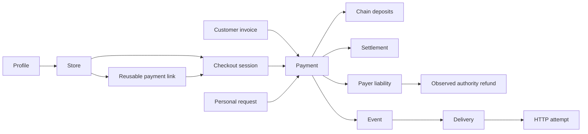

# Merchant payment model

This document owns the product boundaries for merchant payments. PROJECT owns requirements; PLAN owns execution order.

## Responsibilities

| Resource | Responsibility |
|---|---|
| Profile | Tenant, legal issuer, roles and one wallet per chain family. |
| Store | Selling channel, payment attribution, branding, token preferences, allowed origins and checkout defaults. |
| Payment link | Reusable fixed/open offer; each purchase starts an independent checkout. |
| Checkout session | One purchase attempt with immutable amount, source, store, mode and optional external order reference. |
| Invoice | Numbered customer billing document with issuer, recipient, line items and due date. |
| Personal request | A simpler request between people, preserving its existing flow. |
| Payment | Financial aggregate containing accepted options, deposits, held funds and settlement. |
| Settlement | Confirmed movement of merchant entitlement from a receiver to the profile wallet. |
| Refund | Evidence of receiver funds returned by the authority; claim and execution tools belong to PLAN 11.10. |
| Webhook event | A business change with an immutable identity and ordering sequence. |
| Delivery attempt | One HTTP transport attempt; failure does not change payment status. |

- Products and orders remain in the merchant's application.
- Checkout accepts item snapshots and an external order reference; it does not introduce catalog or inventory management.
- A store shares its profile wallet and is not a separate legal entity or spendable balance.
- Existing SQL and receiver contracts remain the shared payment engine; distinct APIs and screens express distinct workflows.

## Lifecycle and evidence

- A reusable link stays available until disabled, ended or its available capacity is exhausted.
- A checkout is open, complete or expired; its payment can independently be confirming, partial, paid or unpaid.
- Paid requires existing finalized-chain and independent balance checks.
- Settlement remains separate: a paid payment can still have settlement pending and excess held for its payer.
- Due date and checkout close remain different invoice concepts.
- Browser redirects, parent messages and customer claims never prove payment.
- Webhook consumers verify signatures, deduplicate event IDs and use canonical reads to recover missing or reordered deliveries.
- Financial exports preserve chain plus token contract, exact base units, decimals and transaction references.
- Held money is a liability, not an initiated refund request.
- Observed returns and booked returns remain distinct; missing preceding records produce an explicit unreconciled condition.
- Refunds reduce net held first, then unsettled merchant payable; neither balance can become negative.
- Record actual authority settlement independently of signer intent; payable-first/held-second allocation makes exceptional held-money settlement visible.
- Preserve all movements in finalized block/log order; finalized balances decide paid and expiry.
- Prevent reopening after confirmed returns; late deposits create new held liabilities.
- Wallet attribution requires actual settlement evidence, not only receiver counterparty and token equality.
- Export one row per booked movement; never repeat aggregate totals as independently summable financial rows.

## Merchant screens

- Payments finds one payment by order reference, customer, amount or status.
- Payment detail owns received amounts, pending amounts, wallet transfers, refunds and transaction history.
- Payment links manage reusable offers and reuse the payment table for resulting purchases.
- Invoices own billing details, document changes and emails, with a link to the payment.
- Activity shows invoice creation as a request and each deposit as money received.
- Invoice requests never count as additional income.
- Wallet transactions describe transfers into the wallet and link back to the payment.
- The notification bell and toasts share canonical payment events.
- Delivery failures never change the customer payment state.

Payment status and wallet transfer are separate facts (D-114). The API derives both: `state` and `wallet`.

| Payment status | Meaning |
|---|---|
| Waiting for payment | No payment is currently being confirmed. |
| Confirming | An on-time transfer is detected, or the full amount is credited and awaits the finalized balance check. |
| Partially paid | Credited payments cover part of the requested amount. |
| Paid | The customer paid the requested amount with the required evidence. |
| Overpaid | Paid, and money is held for the payer on any option: extra, late or sent to another option. |
| Overdue | An unpaid numbered invoice past its due date; the web derives it from `dueDate`. |
| Expired | The checkout closed without completing payment, including a session closed by the expire action. |
| Canceled | The issuer canceled collection. |
| Returned | Recorded money was returned; this does not erase the original receipt. |

| Wallet transfer | Meaning |
|---|---|
| — | Not paid: nothing is due to move. |
| Pending | Paid; the merchant's share is on its way to the wallet. |
| Delayed | The transfer waits for a retry, the daily cap or an unresolved transaction. |
| Needs review | The transfer was refused. |
| In wallet | The wallet transfer completed. |

- Held money is the payer's: it never counts toward Owed to you or the merchant's balance.
- The Paid filter includes payments already in the wallet; the wallet filter narrows that set.
- Received amounts include observed, non-reorged deposits, separated by token and network.
- Each uncredited amount is explicitly labeled confirming; it never increases available merchant funds.
- Normal payment details load used options and relevant problems.
- Transactions and technical details load on demand; transactions use cursor pages.
- Transaction rows keep block, log, evidence and ledger data inside expandable details.
- Missing evidence remains unresolved, even when routine diagnostics are hidden.

## Compatibility and scope

- Add explicit immutable purposes to the existing payment engine instead of renaming its tables or changing receive addresses.
- New checkout sessions never allocate invoice numbers or create an invoice document.
- Existing link attempts retain invoice documents and delayed numbering, including attempts still unnumbered during migration.
- Purpose and attached document kind remain distinct; a legacy checkout may have its original invoice document.
- Preserve original request hashes for in-flight legacy retries.
- Existing issued numbers, document URLs, IDs, invoice API defaults and public webhook names remain compatible under D-104.
- New payment/session read models expose origin independently of document numbering.
- Billing composition identifies the recipient by name or email; existing API invoice defaults remain compatible.
- Notifications retain event names and expose nullable document numbers for checkout.
- Unused pending history creates no warning; conflicting evidence and affected funds retain a clear action.
- Existing link retries replay original requests after template changes; new purchases use fresh attempt identities.
- The purchase URL preserves original input and quoted offer version across refresh, Back and storage failures.
- An uncertain uncommitted request must match its original quote before creating checkout.
- Legacy request hashes remain unchanged; supplied amounts must match original terms.
- Legacy storage cannot prove omitted fixed/open input or old offer versions; new immutable request metadata records both.
- Links retain their original store; moving a selling channel requires another link.
- Capacity checks and reservations happen in the payment transaction, including legacy reopening.
- Canonical open, detected and partly paid purchases reserve slots; paid purchases consume them.
- Canonical expiry frees unused slots; wall time alone cannot release unresolved funds.
- Merchant readiness and failed configuration loads are explained before a customer reaches an unusable payment.
- Wallet activity stays profile-wide under D-93; store payment views and exports honor store access.
- Hosted checkout comes first; embedded checkout is restricted to the store's allowed origins.
- Browser packages never receive secret API keys or decide financial success.
- Full refund claim/execution tools remain PLAN 11.10.
- The Test mode / Live mode switch remains after production contracts, as planned.

## Primary evidence

- [Reusable link and checkout relation](https://docs.stripe.com/api/payment-link).
- [Single-use and reusable link lifecycles](https://docs.adyen.com/unified-commerce/pay-by-link/create-payment-links).
- [Order-correlated crypto checkout](https://doc.heleket.com/host-to-host).
- [Customer invoice lifecycle](https://docs.stripe.com/invoicing/overview).
- [Optional invoices after checkout](https://docs.stripe.com/receipts).
- [Current Coinbase checkout workflow](https://docs.cdp.coinbase.com/coinbase-business/checkout-apis/overview).
- [Webhook duplication and ordering](https://docs.stripe.com/webhooks).

Detailed local research lives in ignored `docs/research/merchant-payment-workflows.md`; tracked requirements and decisions remain sufficient for a fresh checkout.
